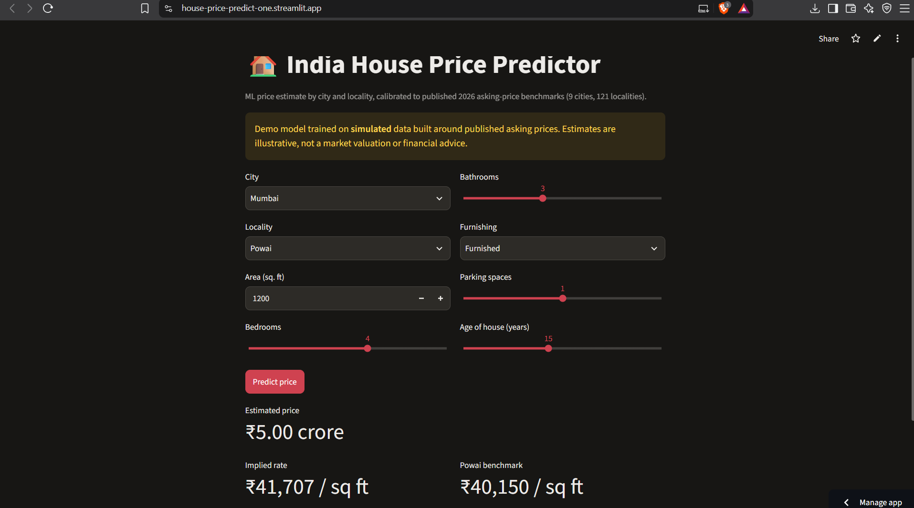

# India House Price Predictor

**Live demo:** [house-price-predict-one.streamlit.app](https://house-price-predict-one.streamlit.app)



A machine-learning house price estimator for **9 Indian cities and 121 localities**. Pick a city and locality, enter the size, bedrooms, bathrooms, parking, furnishing and age, and the app returns an estimated price, the implied rate per sq. ft, and the locality's benchmark rate for comparison.

> **Read this first.** There is no real transaction dataset in this repo. The model is trained on **simulated** listings whose prices are built around approximate 2026 asking rates for each locality. Estimates are illustrative, not a market valuation. Asking prices are usually higher than final sale prices, and listing sites disagree with each other by 20 to 60% for the same locality.

The repo holds two parts:

| Part | Where | What it is |
|---|---|---|
| **Live app model** | `house_price/market.py`, `app.py` | 9 cities, 121 localities, powers the Streamlit demo |
| **Original ML pipeline** | `house_price/data.py`, `modeling.py`, `train.py` | 5-city synthetic dataset used to compare 5 models with cross-validation and tuning |

## Coverage: 9 cities, 121 localities

Benchmark rates are approximate average **asking** prices in ₹ per sq. ft, compiled from property-portal and market-report pages published in 2026. They live in `RATES` in `house_price/market.py` and can be edited freely.

| City | Localities | Rate range (₹ / sq. ft) | Cheapest | Priciest |
|---|---:|---|---|---|
| Delhi | 19 | 5,900 to 50,400 | Mahavir Enclave | R.K. Puram |
| Mumbai | 14 | 13,150 to 105,000 | Kalamboli (Navi Mumbai) | Worli / Malabar Hill |
| Bengaluru | 14 | 7,200 to 32,000 | Electronic City | Sadashivanagar |
| Hyderabad | 14 | 5,400 to 14,100 | Boduppal | Jubilee Hills |
| Pune | 14 | 5,700 to 22,000 | Wagholi | Boat Club Road |
| Chennai | 15 | 5,450 to 20,900 | Urapakkam | Besant Nagar |
| Kolkata | 16 | 4,200 to 17,500 | Kestopur | Park Street |
| Gurugram | 6 | 10,950 to 27,000 | New Gurugram (Sec 82-95) | Golf Course Road |
| Noida | 9 | 7,850 to 14,100 | Noida Extension | Sector 50 |
| **Total** | **121** | | | |

## How the live model works

1. **Simulate listings.** `simulate_listings()` creates 60,000 synthetic listings (seeded, reproducible). Each picks a locality, an area (lognormal around 1,100 sq. ft), bedrooms, bathrooms, parking, furnishing and age.
2. **Price each listing.** Price = area × the locality's benchmark rate × an adjustment factor × random noise (about ±12%). The factor covers:
   - **Size:** smaller flats cost more per sq. ft
   - **Age:** about 0.7% lower per year, down to a floor of 25% off
   - **Furnishing:** semi-furnished +4%, furnished +8%
   - **Parking:** +2.5% per space
   - **Bathrooms vs bedrooms:** a small premium for extra bathrooms
3. **Train.** One-hot encoding for locality and furnishing, then a scikit-learn `HistGradientBoostingRegressor` fitted on `log(price)` with an 80:20 split.
4. **Predict.** `predict_price()` returns the total price, the implied rate per sq. ft and the locality benchmark. An unknown locality, or a locality that belongs to a different city, raises a `ValueError`.

On its own simulated hold-out set the model scores **R² = 0.968**. Because the data is generated from a formula, this only shows that the model learned that pattern. It says nothing about accuracy on real listings.

Sample output (1,200 sq. ft, 3 bed, 2 bath, 1 parking, semi-furnished, 5 years old):

| Locality | Estimate | Implied rate | Benchmark |
|---|---:|---:|---:|
| Mumbai, Bandra West | ₹7.54 crore | ₹62,799 | ₹65,650 |
| Delhi, R.K. Puram | ₹6.00 crore | ₹50,005 | ₹50,400 |
| Bengaluru, Koramangala | ₹2.07 crore | ₹17,224 | ₹16,650 |
| Hyderabad, Gachibowli | ₹1.45 crore | ₹12,076 | ₹11,700 |
| Kolkata, New Town | ₹1.02 crore | ₹8,494 | ₹8,400 |

## The original ML pipeline (synthetic 5-city dataset)

The project started as a 3-feature linear regression and grew into a full workflow: 2,000 synthetic houses across 5 cities with 9 features and about 6% missing values, median and most-frequent imputation, scaling and one-hot encoding inside one scikit-learn `Pipeline`, log-transformed prices, 5-fold cross-validation and `GridSearchCV` tuning. The best model was chosen on cross-validation only, so the 400-house test set stays unbiased.


| Model | CV RMSE | Test RMSE (lakhs) | Test MAE | Test R² |
|-------|--------:|------------------:|---------:|--------:|
| Baseline: 3-feature linear regression | 52.8 | 49.5 | 35.2 | 0.428 |
| Linear Regression | 23.6 | 18.1 | 10.4 | 0.924 |
| Ridge | 23.5 | 18.1 | 10.4 | 0.924 |
| Lasso | 23.3 | 17.9 | 10.4 | 0.925 |
| Random Forest (tuned) | 18.9 | 15.2 | 9.9 | 0.946 |
| **Gradient Boosting (tuned)** | **12.7** | **12.4** | **7.6** | **0.964** |

The tuned Gradient Boosting model cuts test RMSE by about **75%** against the 3-feature baseline. City and area drive most of the price, followed by location score, age and distance from the centre. These scores belong to this original pipeline, **not** to the live app model above. Full numbers are in `reports/model_comparison.csv` and `reports/metrics.json`.

| | |
|---|---|
|  |  |

## Getting started

```bash
pip install -r requirements.txt

streamlit run app.py                    # the live app; trains the model in a few seconds on first start
python -m house_price.market            # train the live model and print sanity checks
python -m pytest                        # run all 26 tests
```

The original pipeline:

```bash
python -m house_price.train             # compare models, tune, save reports (~1 min)
python -m house_price.train --no-tune   # faster run without grid search

python -m house_price.predict --area 1500 --bedrooms 3 --bathrooms 2 \
    --age 5 --location-score 7.5 --distance 6 --parking 1 \
    --city Bengaluru --furnishing Semi-furnished
```

## Project structure

```
house-price-prediction/
├── app.py                  # Streamlit web app (uses house_price/market.py)
├── app_screenshot.png
├── house_price/
│   ├── market.py           # live model: 9 cities, 121 localities, RATES table
│   ├── config.py           # original pipeline: paths, feature lists
│   ├── data.py             # original pipeline: synthetic 5-city dataset
│   ├── modeling.py         # original pipeline: preprocessing, models, metrics
│   ├── train.py            # original pipeline: CV, tuning, evaluation
│   ├── predict.py          # original pipeline: single-house command line
│   └── plots.py            # figures
├── tests/
│   ├── test_house_price.py # original pipeline tests
│   └── test_market.py      # live model tests
├── data/house_data.csv     # synthetic 5-city dataset
├── models/                 # saved models
├── reports/                # metrics.json, model_comparison.csv, figures/
├── .devcontainer/          # GitHub Codespaces setup
└── requirements.txt
```

## Limitations

- Training data is simulated, so there is no real-world accuracy claim.
- Benchmark rates are asking prices and approximate. Update `RATES` with your own source for current numbers.
- Only 121 named localities are supported; there is no free-text address lookup.
- No data on floor level, builder, amenities or exact micro-location.

## Future work

- Train on a real listings dataset and compare against the simulated results
- Add more localities and refresh `RATES` regularly
- Try LightGBM or XGBoost, add SHAP explanations and prediction intervals

## Tech stack

Python, NumPy, Pandas, scikit-learn, Matplotlib, Streamlit, pytest

## Author

Shubham, B.Tech Mathematics & Computing, Delhi Technological University
